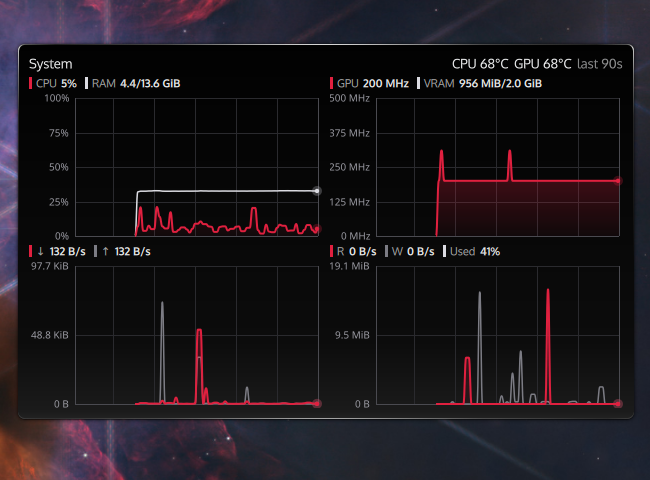
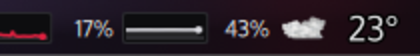

# System Strip

A compact KDE Plasma 6 desktop widget that shows live history charts for CPU, RAM, GPU, network and disk in one panel. The charts use a dark grid and a crimson accent, styled like a meteogram.



## What it shows

| Chart | Filled line | Thin line | Readouts |
|---|---|---|---|
| CPU / RAM | CPU usage % | RAM used % | CPU %, RAM used / total |
| GPU | GPU usage % (or core clock) | VRAM used % | GPU %, VRAM used / total |
| Network | Download | Upload | ↓ / ↑ rate |
| Disk | Read | Write | read / write rate, disk used % |

The header shows CPU and GPU temperature when the sensors report one. Each value turns crimson at 85 °C or above.

On the desktop the widget draws its charts in place. In a horizontal panel it shows two tiny live sparklines with percentages, CPU in crimson and RAM in silver, and clicking them opens the full charts as a popup. In a vertical panel it falls back to an icon.



## Requirements

- KDE Plasma 6.0 or newer
- `ksystemstats`, which ships with Plasma and provides the sensors

The widget runs no commands, reads no files and makes no network requests. Every value comes from Plasma's sensor service (`org.kde.ksysguard.sensors`).

## Install

```sh
git clone https://github.com/sarwar-uddin/plasma-system-strip.git
cd plasma-system-strip
kpackagetool6 -t Plasma/Applet -i package
```

Then right-click the desktop, choose **Add or Manage Widgets…**, and search for **System Strip**.

To upgrade after a `git pull`, run:

```sh
kpackagetool6 -t Plasma/Applet -u package
```

If the widget still looks unchanged, restart Plasma with `systemctl --user restart plasma-plasmashell.service`.

To uninstall, run:

```sh
kpackagetool6 -t Plasma/Applet -r com.github.sarwaruddin.systemstrip
```

## Settings

Right-click the widget and choose **Configure System Strip…**.

| Setting | Default | Notes |
|---|---|---|
| GPU | `gpu/gpu0` | Use `gpu/gpu1` and so on to pick another GPU. `gpu/all` combines all of them. |
| GPU chart shows | Usage | **Core clock** plots the clock speed in MHz. Use it on GPUs whose busy % is broken (see below). |
| Disk | `disk/all` | Or a single device, for example `disk/nvme0n1`. |
| Network | `network/all` | Or a single interface. |
| History | 90 s | From 20 to 600 seconds. |

To see the sensor IDs on your machine, run:

```sh
qdbus6 --literal org.kde.ksystemstats1 /org/kde/ksystemstats1 \
  org.kde.ksystemstats1.allSensors | grep -oE '"(gpu|disk|network)/[^"]+"' | sort -u
```

## Known quirks

- **Hybrid-GPU laptops:** pointing the widget at the discrete NVIDIA GPU makes `ksystemstats` poll it through `nvidia-smi`, which keeps that GPU powered on and costs battery. Point it at the integrated GPU instead, usually `gpu/gpu1`.
- **AMD Raven / Picasso APUs** (Ryzen 2000/3000 mobile with Vega graphics) can report a constant 100 % in `gpu_busy_percent` even when idle. This is a driver/firmware bug, not a widget bug. Set **GPU chart shows** to **Core clock**.
- The charts start empty and fill from the right, one sample per second.

## Files

```
package/
  metadata.json
  contents/config/main.xml      settings schema
  contents/config/config.qml    settings pages
  contents/ui/main.qml          sensors, history buffers, layout
  contents/ui/Quadrant.qml      one chart cell (legend + chart)
  contents/ui/HistoryChart.qml  Canvas chart: grid, smoothed lines, gradient fill
  contents/ui/Sparkline.qml     tiny panel chart
  contents/ui/configGeneral.qml settings page
```

## License

GPL-2.0-or-later. See [LICENSE](LICENSE).
